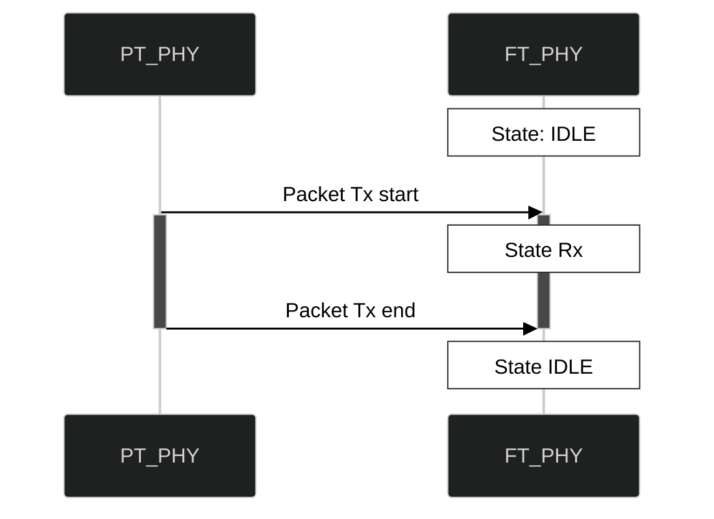
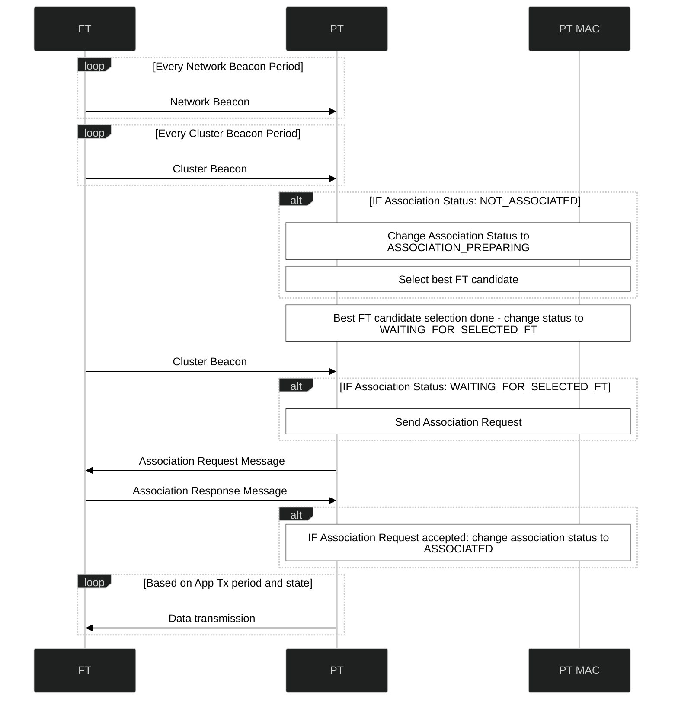
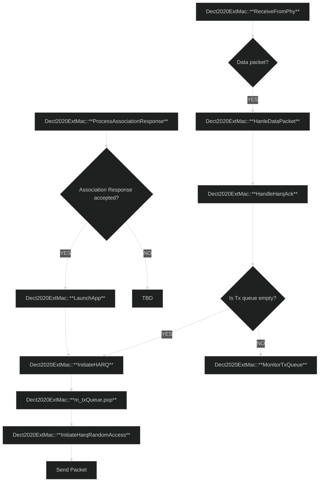

# Design Documentation of the DECT NR+ NS-3 Implementation
# Configuration
The project can be configured through the `config` model located in `/model/config`.
The configuration model is divided into two parts: `dect2020ext-config-values` (a single header file) and `dect2020ext-config` (config class).
`dect2020ext-config-values` contains configuration variables that are used by `dect2020ext-config` to configure `dect2020ext` models.

The `Dect2020ExtConfig` class creates two objects that are shared by all `Dect2020Ext` models:
- Spectrum Channel
- Channel Manager
`Dect2020ExtConfig` also creates an Isotropic Antenna for every PHY.
`Dect2020ExtConfig` has `ApplyToPhy` and `ApplyToMac` functions that bootstrap the values from `dect2020ext-config-values` to the corresponding `Dect2020ExtPhy` and `Dect2020ExtMac` models.
# Logging
The default logging setup (logging levels) looks like this:
```c++
LogComponentEnable("Dect2020ExtMac", LogLevel(LOG_LEVEL_INFO | LOG_PREFIX_TIME | LOG_PREFIX_FUNC));
LogComponentEnable("Dect2020ExtPhy", LogLevel(LOG_LEVEL_INFO | LOG_PREFIX_TIME | LOG_PREFIX_FUNC));
LogComponentEnable("Dect2020ExtStatistics", LogLevel(LOG_LEVEL_INFO));
```
Logging levels are usually defined at the start of every simulation script.

Usually, simulation scripts produce an extremely large amount of logs.
`splitlogs.py` Python divides the logs into separate files based on the identity of objects.
The identity of objects is constructed from their node's index and operational mode: Fixed Termination point (FT) or Portable Termination point (PT).

Each PHY and MAC object has its own `PHY_IDENTITY` or `MAC_IDENTITY`.
This is important for logging since it allows to divide the logs from different models into separate files.
The current default way of logging information (for MAC for example) is:
```c++
NS_LOG_INFO(MAC_IDENTITY << "some interesting information");
```
Note, if the information is logged without using a proper identity, the logs will not be separated correctly by the `splitlogs.py` script.
# Statistics
The `Dect2020ExtStatistics` model currently supports logging the number of accepted and dropped packets based on the `PHY_IDENTITY`.
# Initialization
# Initializing Network
# Spectrum Management Procedure
# Beacon Transmission

# PHY Rx State Machine


# Association Procedure



# HARQ and Random Access Procedure
## HARQ
In DECT NR+, the procedure responsible for automatic retransmissions if packets are dropped or not correctly decoded is Hybrid Automatic Repeat Request (HARQ). Even though this procedure is referred to as "HARQ" in the code base, the procedure is not fully implemented.
The current "HARQ" implementation only involves Automatic Repeat Request (ARQ) method with 1 HARQ process.
The repeat requests are done upon the timeout (RACH response window exceeds and no ACK has been received).
The RACH response window should always be longer than HARQ feedback delay to give the FT time to respond to the packet.
The processing time for creating the feedback is two subslots or as indicated by the RD in the `HARQ feedback delay` field in RD capability IE.
Feedback delay: n + `HARQ feedback delay` + 1.


