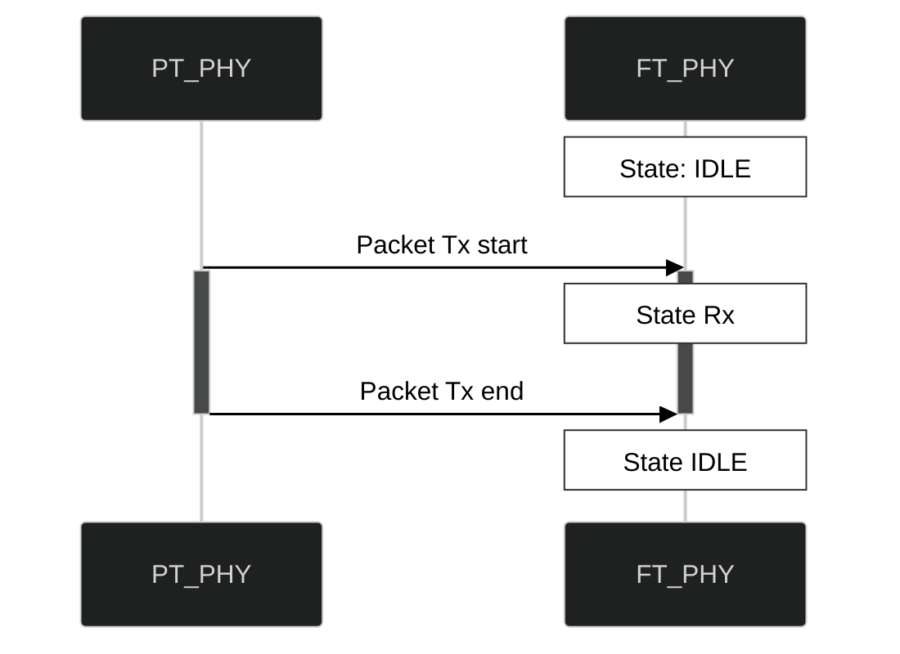
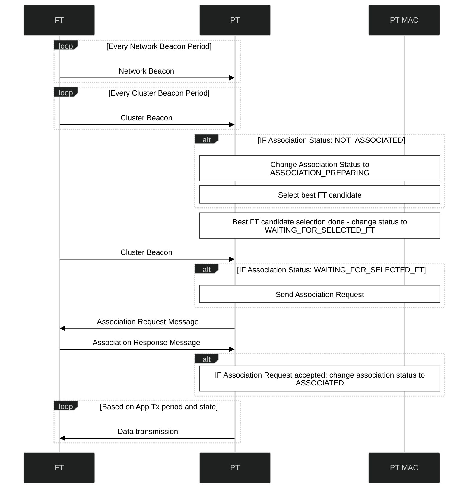
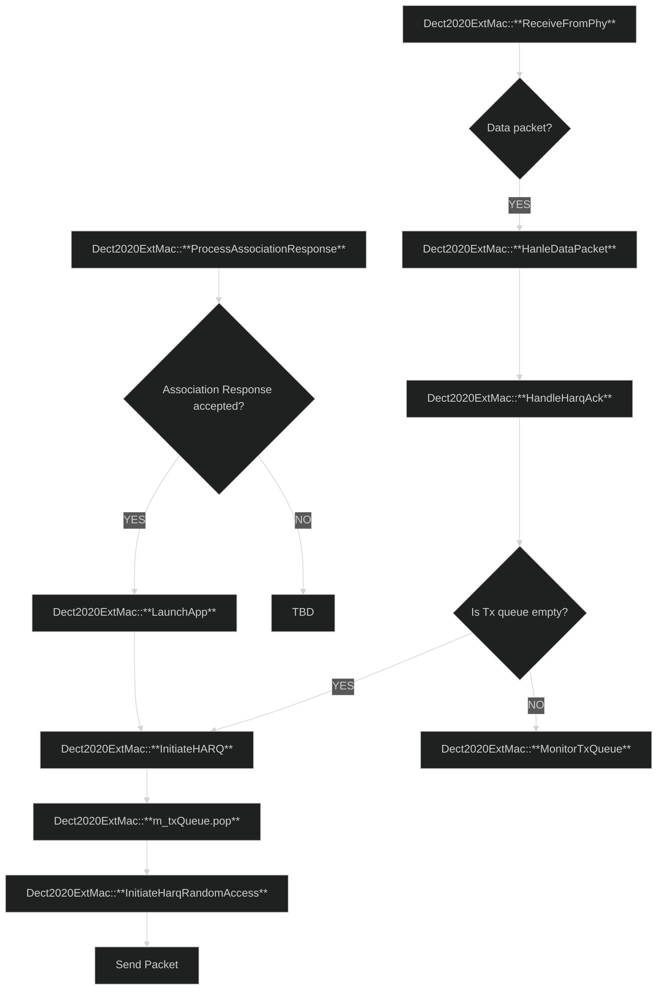
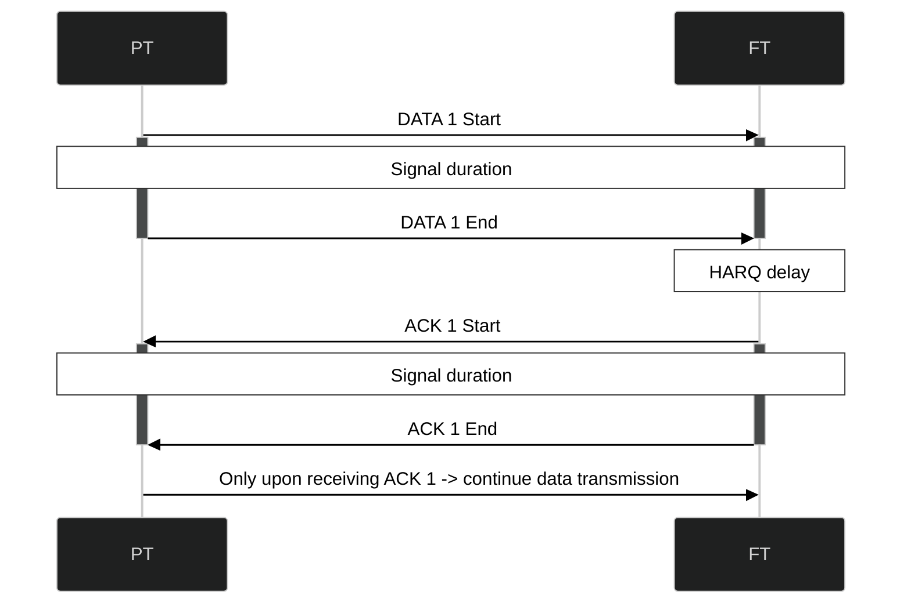

# 1 Quick Links
DECT-2020 New Radio (NR):
- [Part 2: Radio reception and transmission requirements; ETSI TS 103 636-2 V2.1.1](https://www.etsi.org/deliver/etsi_ts/103600_103699/10363602/02.01.01_60/ts_10363602v020101p.pdf)
- [Part 3: Physical layer; ETSI TS 103 636-3 V2.1.1](https://www.etsi.org/deliver/etsi_ts/103600_103699/10363603/02.01.01_60/ts_10363603v020101p.pdf)
- [Part 4: MAC layer; ETSI TS 103 636-4 V2.1.1](https://www.etsi.org/deliver/etsi_ts/103600_103699/10363604/02.01.01_60/ts_10363604v020101p.pdf)
[ns-3](https://www.nsnam.org/)
# 2 Configuration
The project can be configured through the `config` model located in `/model/config`.
The configuration model is divided into two parts: `dect2020ext-config-values` (a single header file) and `dect2020ext-config` (config class).
`dect2020ext-config-values` contains configuration variables that are used by `dect2020ext-config` to configure `dect2020ext` models.

The `Dect2020ExtConfig` class creates two objects that are shared by all `Dect2020Ext` models:
- Spectrum Channel
- Channel Manager
`Dect2020ExtConfig` also creates an Isotropic Antenna for every PHY.
`Dect2020ExtConfig` has `ApplyToPhy` and `ApplyToMac` functions that bootstrap the values from `dect2020ext-config-values` to the corresponding `Dect2020ExtPhy` and `Dect2020ExtMac` models.
# 3 Logging
The default logging setup (logging levels) looks like this:
```c++
LogComponentEnable("Dect2020ExtMac", LogLevel(LOG_LEVEL_INFO | LOG_PREFIX_TIME | LOG_PREFIX_FUNC));
LogComponentEnable("Dect2020ExtPhy", LogLevel(LOG_LEVEL_INFO | LOG_PREFIX_TIME | LOG_PREFIX_FUNC));
LogComponentEnable("Dect2020ExtStatistics", LogLevel(LOG_LEVEL_INFO));
```
Logging levels are usually defined at the start of every simulation script.

Usually, simulation scripts produce an extremely large amount of logs.
`splitlogs.py` Python divides the logs into separate files based on the identity of objects.
The identity of objects is constructed from their node's index and operational mode: Fixed Termination point (FT) or Portable Termination point (PT).

Each PHY and MAC object has its own `PHY_IDENTITY` or `MAC_IDENTITY`.
This is important for logging since it allows to divide the logs from different models into separate files.
The current default way of logging information (for MAC for example) is:
```c++
NS_LOG_INFO(MAC_IDENTITY << "some interesting information");
```
Note, if the information is logged without using a proper identity, the logs will not be separated correctly by the `splitlogs.py` script.
# 4 Statistics
The `Dect2020ExtStatistics` model currently supports logging the number of accepted and dropped packets based on **the** `PHY_IDENTITY`.
# 5 PHY Rx State Machine


# 6 Association Procedure



# 7 HARQ and Random Access Procedure
## 7.1 HARQ
In DECT NR+, the procedure responsible for automatic retransmissions if packets are dropped or not correctly decoded is Hybrid Automatic Repeat Request (HARQ). Even though this procedure is referred to as "HARQ" in the code base, the procedure is not fully implemented.
The current "HARQ" implementation only involves Automatic Repeat Request (ARQ) method with 1 HARQ process.
The repeat requests are done upon the timeout (RACH response window exceeds and no ACK has been received).
The RACH response window should always be longer than HARQ feedback delay to give the FT time to respond to the packet.
The processing time for creating the feedback is two subslots or as indicated by the RD in the `HARQ feedback delay` field in RD capability IE.
Feedback delay: n + `HARQ feedback delay` + 1.


# 8 Data Transmission
## 8.1 Stop-and-Wait ARQ

## 8.2 General Description
Data transmission is implemented via HARQ operation and Random Access. MAC PDU formats that belong to HARQ and Random Access are used to configure how data transmission will happen.

# 9 MAC PDU Size Calculation Based on Modulation and Coding Scheme (MCS)
The MAC PDU size calculation in slots and subslots is implemented at the MAC level: `Dect2020ExtMac::CalculateMacPduSizeInSlots` and `Dect2020Ext::CalculateMacPduSizeInSubslots`. Both functions have a single parameter - `uint32_t packetLengthInBytes`. The Transport Block Size (TBS) values for single slot transmission and single spatial stream with maximum turbo code block size of 2048 bits are derived from [ETSI TS 103 636-3 V2.1.1](https://www.etsi.org/deliver/etsi_ts/103600_103699/10363603/02.01.01_60/ts_10363603v020101p.pdf#%5B%7B%22num%22%3A336%2C%22gen%22%3A0%7D%2C%7B%22name%22%3A%22FitH%22%7D%2C540%5D) Table C.2-1.
The table is implemented as follows:
```c++
const std::vector<uint16_t> Dect2020ExtPhy::m_singleSlotSingleStreamTransportBlockSizesMu1Beta1
{
    136,  // MCS 0
    296,  // MCS 1
    456,  // MCS 2
    616,  // MCS 3
    936,  // MCS 4
    1256, // MCS 5
    1416, // MCS 6
    1576, // MCS 7
    1896, // MCS 8
    2040, // MCS 9
    2296, // MCS 10
    2552  // MCS 11
};
```

The computation of MAC PDU size in slots and subslots is as follows:
1. Convert size from bytes to bits by multiplying `packetLengthInBytes` by 8.
2. Get MCS Transport Block Size (TBS) by calling `Dect2020ExtPhy::GetMcsTransportBlockSize` and passing alpha, beta, and configured MCS index (at the MAC level) to the function and storing the result in `mcsTransportBlockSizeBitsPerSlot`.
3. If the length is calculated in subslots:
	1. Get subslots per slot from `Dect2020ExtChannelManager` and store the result in `subslotsPerSlot`
	2. Calculate transport block size per subslot by dividing `mcsTransportBlockSizeBitsPerSlot` by `subslotsPerSlot`
	3. Calculate packet MAC PDU length in subslots (with rounding up)  by calling `std::ceil(packetLengthInBits / mcsTransportBlockSizeBitsPerSubslot`
4. If the length is calculated in slots:
	1. Calculate packet length in slots (with rounding up) by calling `std::ceil(packetLengthInBits / mscTransportBlockSizeBitsPerSlot`
# 10 MAC PDU
All MAC PDU formats are serialized with host to network byte order (big-endian) and deserialized with network to host byte order (small-endian).
## 10.1 Currently implemented MAC PDU formats
- [Physical Header Field](https://www.etsi.org/deliver/etsi_ts/103600_103699/10363604/02.01.01_60/ts_10363604v020101p.pdf#%5B%7B%22num%22%3A404%2C%22gen%22%3A0%7D%2C%7B%22name%22%3A%22FitH%22%7D%2C347%5D):
	- Type 1, Header Format: 000
	- Type 2, Header Format: 000
	- Type 2, Header Format: 001
- [MAC Header Type](https://www.etsi.org/deliver/etsi_ts/103600_103699/10363604/02.01.01_60/ts_10363604v020101p.pdf#%5B%7B%22num%22%3A568%2C%22gen%22%3A0%7D%2C%7B%22name%22%3A%22FitH%22%7D%2C350%5D)
- MAC Common Headers:
	- [Beacon Header](https://www.etsi.org/deliver/etsi_ts/103600_103699/10363604/02.01.01_60/ts_10363604v020101p.pdf#%5B%7B%22num%22%3A691%2C%22gen%22%3A0%7D%2C%7B%22name%22%3A%22FitH%22%7D%2C455%5D)
	- [Data MAC PDU](https://www.etsi.org/deliver/etsi_ts/103600_103699/10363604/02.01.01_60/ts_10363604v020101p.pdf#%5B%7B%22num%22%3A691%2C%22gen%22%3A0%7D%2C%7B%22name%22%3A%22FitH%22%7D%2C619%5D)
	- [RD Broadcasting Header](https://www.etsi.org/deliver/etsi_ts/103600_103699/10363604/02.01.01_60/ts_10363604v020101p.pdf#%5B%7B%22num%22%3A763%2C%22gen%22%3A0%7D%2C%7B%22name%22%3A%22FitH%22%7D%2C445%5D)
	- [Unicast Header](https://www.etsi.org/deliver/etsi_ts/103600_103699/10363604/02.01.01_60/ts_10363604v020101p.pdf#%5B%7B%22num%22%3A691%2C%22gen%22%3A0%7D%2C%7B%22name%22%3A%22FitH%22%7D%2C218%5D)
- [MAC Multiplexing Header](https://www.etsi.org/deliver/etsi_ts/103600_103699/10363604/02.01.01_60/ts_10363604v020101p.pdf)
	- Type A
## 10.2 MAC PDU Macros
`DECT2020EXT_MAC_PDU_FATAL(message, outputValue)` - outputs a fatal error with the message and the output value (which is wrong in this case)
# 11 Available Tests
- Physical Header Field:
	- Serialization/Deserialization tests:
		- PHY Control Field: Type 1, Header Format: 000
		- PHY Control Field: Type 2, Header Format: 000
		- PHY Control Field: Type 2, Header Format: 001
- MAC Header Type:
	- Serialization/Deserialization test
- MAC Common Headers:
	- Serialization/Deserialization tests:
		- Beacon Header
		- Data MAC PDU
		- RD Broadcasting Header
		- Unicast Header
## 11.1 MAC PDU Tests
All serialization/deserialization tests for MAC Common Headers are implemented with the following principle:
1. Two header objects are initiated - one for the original header and one for the deserialized header
2. One packet object is initiated to simulate adding headers to MAC PDU
3. Values for header fields are generated randomly, for example:
```c++
std::random_device rd;
std::mt19937 mt(rd());
std::uniform_int_distribution<uint32_t> networkIdDist(0, 0xFFFFFF);
std::uniform_int_distribution<uint32_t> transmitterAddressDist(0, 0xFFFFFFFF);

uint32_t networkId = networkIdDist(mt); // 24-bit ID
uint32_t transmitterAddress = transmitterAddressDist(mt); // 32-bit address

originalHeader.SetNetworkId(networkId);
originalHeader.SetTransmitterAddress(transmitterAddress);
```
4. When adding header to the packet, the size of the packet before and after addition is also tested
## 11.2 Running Tests
All tests can be executed with the `test.py` ns-3 script:
1. Navigate to the root directory of ns-3
2. To run all `dect2020ext` tests, run this command in the terminal:
```bash
python test.py --suite="dect2020ext*"
```
3. To run a specific `TestSuite`, run this command in the terminal (regex can also be used to specify what to run):
```bash
python test.py --suite="dect2020ext-beacon*"
```

Tips:
1. To be 100% sure that the tested models work correctly, it is probably a good idea to run tests a couple of times. Some tests, for example, MAC Common Header tests, can be tested with random values and therefore should be tested a couple of times to see how the models behave with different random values.
# 12 Future Work
## 12.1 Dect2020ExtTypes
